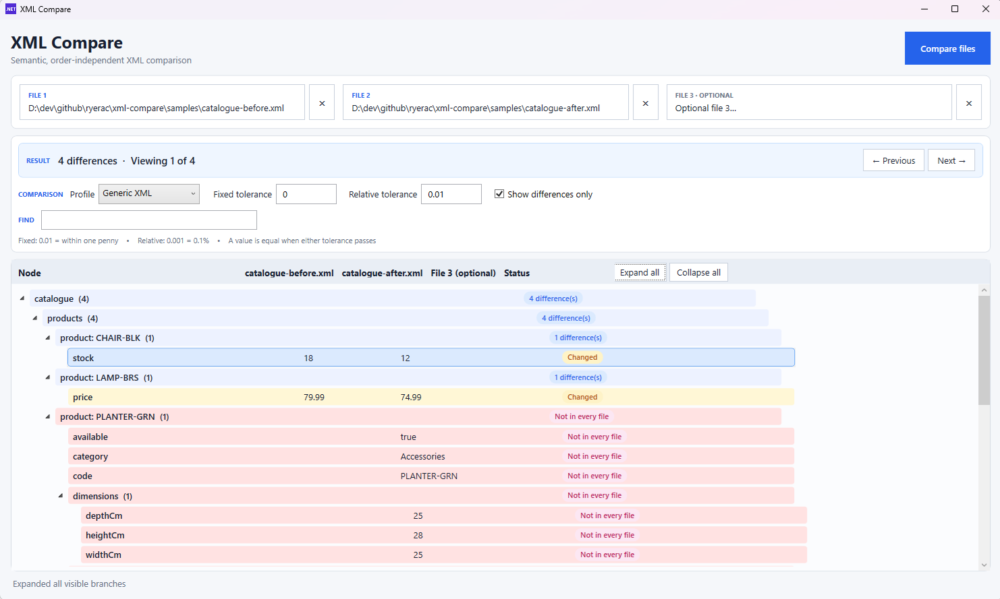

# XML Compare

A read-only Windows desktop application for semantic XML comparison. It compares two or three documents as logical trees, matches reordered collection items, and highlights changed or missing values.

A little rough around the edges, built as a tool to do a specific task for my job.



## Run

```powershell
dotnet run --project .\src\XmlCompare\XmlCompare.csproj
```

In VS Code, open the repository folder and press **F5**. The included `XML Compare (WPF)` launch configuration builds and starts the app with the debugger attached.

## Single executable

Create a self-contained Windows x64 executable with:

```powershell
dotnet publish .\src\XmlCompare\XmlCompare.csproj -p:PublishProfile=SingleFile
```

The result is `artifacts\publish\win-x64\XmlCompare.exe`. It does not require a separate .NET installation. Published builds use built-in Generic defaults; place an optional `Profiles` directory beside the executable to distribute additional comparison profiles.

## Releases

Every branch push and pull request is built and tested by GitHub Actions. CI does not upload build artifacts.

To publish a release, create and push a semantic version tag:

```powershell
git tag v1.0.0
git push origin v1.0.0
```

Tags matching `v*` start the release workflow. It validates tags such as `v1.2.3` or `v1.2.3-beta.1`, runs the build and tests, publishes the self-contained Windows x64 executable, and creates a GitHub Release with generated release notes and `XmlCompare-win-x64.exe` attached.

Drop two or three XML files onto the window, or choose them with the file buttons.

For a quick demonstration, compare [`samples/catalogue-before.xml`](samples/catalogue-before.xml) with [`samples/catalogue-after.xml`](samples/catalogue-after.xml) using the Generic XML profile. The products and tags are deliberately reordered, while a small set of genuine changes demonstrates changed, added, and removed values.

Set **Fixed tolerance** to `0.01` for the demo. The desk price differs by only `0.005`, so it is treated as equal, while the four meaningful differences remain visible. Set the tolerance back to `0` to reveal that small numeric difference as well.

## Profiles

Profiles teach XML Compare how to interpret a document without putting domain-specific rules in the comparison engine. They are JSON files in [`profiles`](profiles) during development. For a published executable, custom profiles can be placed in a `Profiles` directory beside `XmlCompare.exe`.

The bundled [`Generic.json`](profiles/Generic.json) contains conservative defaults and no document-specific rules. Copy it under a new filename to create a custom profile.

See **[Creating comparison profiles](docs/profiles.md)** for a complete generic example and explanations of matching keys, composite identities, display labels, ignored paths, and numeric tolerances.

The comparison never modifies source XML files. DTD processing and external XML resolution are disabled.
